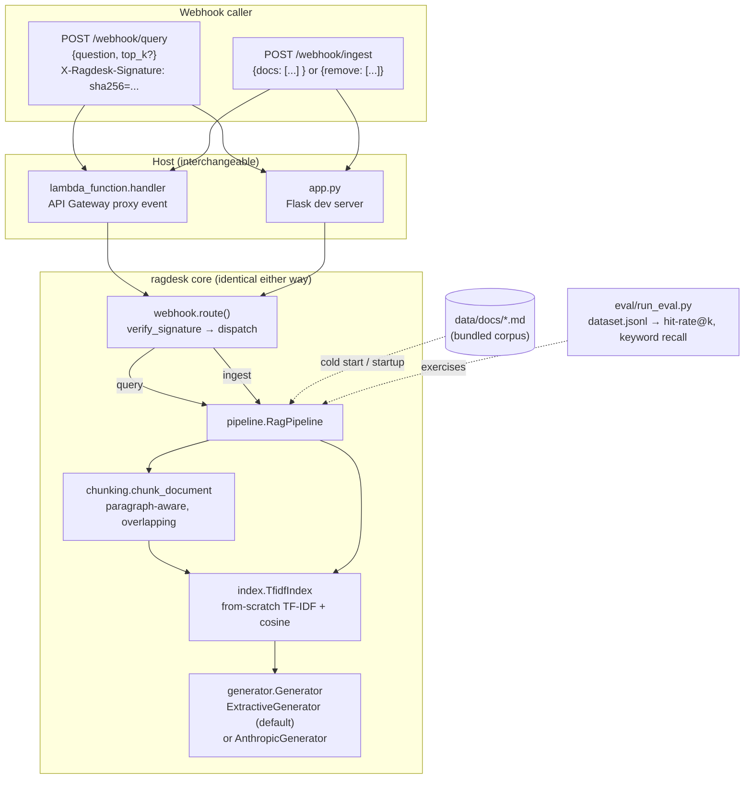

# ragdesk

**A webhook-triggered RAG assistant, deployable as a serverless function,
with an eval harness that measures whether it actually answers correctly.**

Send it a question over a signed webhook; it retrieves the most relevant
passages from an indexed knowledge base and answers, citing which document
backed the answer. Send it a second webhook when the underlying docs
change, and the index updates live — no redeploy. It runs as a single AWS
Lambda function behind API Gateway, and ships with an eval suite that scores
retrieval and answer quality so a change to chunk size, `top_k`, or the
generator can be judged by a number instead of a feeling.

---

## 1. The problem this solves

A support or customer-success tool that answers questions from a company's
internal docs has three integration problems that have nothing to do with
the language model itself:

1. **Getting a question in and an answer out** usually happens over a
   webhook or API call from whatever system is asking (a chat widget, a
   ticketing tool, another SaaS platform) — and that call needs to be
   authenticated, because an unsigned endpoint that runs retrieval and
   generation on arbitrary input is an open door.
2. **Keeping the knowledge base current** without a deploy cycle. Docs
   change; the index has to reflect that the moment the source system says
   so, not after someone remembers to re-run a build.
3. **Knowing whether it still works** after any of the above changes. "The
   demo looked right" is not a regression test.

ragdesk is the smallest system that has all three problems and solves each
one directly, rather than papering over them with a framework:

- a **from-scratch TF-IDF retriever** (no vector DB, no embedding API call,
  nothing that needs a network connection or an API key to run) over markdown
  documents, chunked with paragraph-aware overlap;
- a **pluggable generator** — an offline extractive default that stitches an
  answer straight from the retrieved text (what runs in CI and in the eval),
  with an optional Claude backend behind the same interface;
- two **HMAC-signed webhooks** (`/webhook/query`, `/webhook/ingest`), signed
  the same way GitHub, Stripe, and Slack sign their webhook deliveries;
- a **serverless deployment** (AWS SAM / Lambda + API Gateway) that reuses
  the exact same routing and pipeline code the local Flask dev server runs,
  so nothing behaves differently once deployed;
- an **eval harness** that runs a labeled question set through the live
  pipeline and reports retrieval hit-rate and answer keyword-recall — not a
  vibe check.

The knowledge base it demos against is this monorepo's own project READMEs
(`raftsim`, `vecsearch`, `txnkv`, `repodoc`, `modelwatch`) — so "ask a
question, get a correctly-sourced answer about a real system" is testable
end to end with nothing to configure.

---

## 2. Architecture



```
query:  verify_signature(secret, body)
          └─▶ TfidfIndex.search(question) → top-k chunks (cosine over TF-IDF)
                └─▶ Generator.generate(question, chunks) → answer text
                      └─▶ {request_id, answer, sources[], latency_ms}   (logged as one JSON line)

ingest: verify_signature(secret, body)
          └─▶ for each doc: remove_doc(old) → chunk_document(new) → index.upsert(chunks)
          └─▶ for each id in "remove": index.remove_doc(id)
```

`webhook.py` and `pipeline.py` know nothing about Flask or Lambda — both
hosts parse their own request shape into `(method, path, headers, raw_body)`
and call the same `route()`. That is the whole reason a behavior verified
against the Flask test client is trustworthy once it's running in Lambda.

---

## 3. Install & run locally

```sh
git clone <this repo> && cd ragdesk
python -m venv .venv && source .venv/bin/activate
pip install -e '.[dev]'
pytest -q                      # 50 tests, no network, no API key needed
```

Start the dev server and fire a couple of signed webhooks at it:

```sh
RAGDESK_WEBHOOK_SECRET=demo-secret ./scripts/demo.sh
```

That script starts `python -m ragdesk.app`, which on boot ingests every
`.md` file in `data/docs/` (the five sibling READMEs), then:

1. signs and POSTs a question to `/webhook/query`,
2. signs and POSTs a new document to `/webhook/ingest`,
3. asks a question about that just-ingested document — proving the index
   updated live, with no restart.

To sign a request by hand (e.g. with `curl`):

```sh
BODY='{"question": "What algorithm does vecsearch implement?"}'
SIG=$(python -m ragdesk.cli sign --secret "$RAGDESK_WEBHOOK_SECRET" --body "$BODY")
curl -X POST http://127.0.0.1:8080/webhook/query \
  -H "Content-Type: application/json" \
  -H "X-Ragdesk-Signature: $SIG" \
  -d "$BODY"
```

---

## 4. Deploying as a serverless function

`template.yaml` is an [AWS SAM](https://docs.aws.amazon.com/serverless-application-model/)
template: one Lambda function (`ragdesk.lambda_function.handler`), fronted by
an HTTP API with the same two routes.

```sh
pip install aws-sam-cli   # if you don't have it
sam build
sam deploy --guided \
  --parameter-overrides WebhookSecret=<a-long-random-secret>
```

`sam deploy --guided` prints the invoke URL on completion
(`https://<id>.execute-api.<region>.amazonaws.com`). The function cold-starts
by ingesting `data/docs/` — the same bundled corpus the local server uses —
so it answers correctly on the very first request, with zero external
dependencies or API keys required.

**Two things to know before this goes further than a demo:**

- The index lives in the function's memory. A warm Lambda instance sees an
  `/webhook/ingest` update immediately; a fresh cold start rebuilds from
  `data/docs/` only, and concurrent warm instances don't share writes with
  each other. A real deployment persists the index (S3, DynamoDB, EFS) and
  loads it at cold start instead of re-chunking on every fresh container.
- `RAGDESK_WEBHOOK_SECRET` is a Lambda environment variable here for
  simplicity; in production it belongs in Secrets Manager / SSM Parameter
  Store, read at cold start.

---

## 5. The retriever, briefly

`index.py` is a plain inverted index: tokenize, drop a short stop-list,
weight each term by TF-IDF (`log((1 + N) / (1 + df)) + 1`), and rank chunks
against a query by cosine similarity over those weights. No numpy, no
external index — at the scale this targets (a handful of chunked documents
per tenant), a pure-Python postings list is fast enough and has nothing to
deploy alongside it.

`chunking.py` packs paragraphs greedily up to `max_chars` (default 900),
carrying `overlap_chars` (default 150) of trailing text into the next chunk
so a fact that lands on a chunk boundary is still retrievable from either
side. A paragraph larger than `max_chars` on its own is kept whole rather
than cut mid-sentence or mid-code-block.

This is deliberately swappable: `index.py` and `generator.py` are each one
class behind a narrow interface (`search()`, `generate()`). Pointing
`RagPipeline` at a real embedding model and a vector store, or at Claude
instead of the extractive fallback, is a one-line change in `pipeline.py` —
nothing in `webhook.py`, `app.py`, or `lambda_function.py` has to know.

---

## 6. Eval: does it actually answer correctly?

```sh
python -m eval.run_eval
```

`eval/dataset.jsonl` has 15 questions against the bundled knowledge base,
each with the document that should back the answer and the keywords a
correct answer should contain. The harness reports:

- **retrieval hit-rate@k** — did a chunk from the *correct* source document
  make it into the top-k retrieved chunks? This isolates retrieval from
  generation: a wrong final answer with the right source is a generator
  problem, not a retriever problem.
- **keyword recall** — what fraction of the expected keywords appear in the
  generated answer. A cheap, fully offline stand-in for an LLM-judge grader.

Latest run, against the default `ExtractiveGenerator` (`top_k=4`):

| metric | value |
|---|---|
| cases | 15 |
| retrieval hit-rate@k | **100%** |
| mean keyword recall | **84%** |
| mean latency | 0.53 ms |

Full per-question output is in [`eval/results.json`](eval/results.json). The
84% is the honest number, not a tuned one — e.g. `q5` ("What does MVCC stand
for?") retrieves the right chunk every time but the extractive generator
picks a sentence that doesn't spell out "multi-version" verbatim, which is
exactly the kind of retrieval-vs-generation gap this eval exists to surface
before a user hits it. Swapping in `AnthropicGenerator` (set
`ANTHROPIC_API_KEY`) answers those in full sentences instead of extracted
fragments; re-running the eval after that swap is the point of having one.

---

## 7. Project layout

```
ragdesk/
  chunking.py          paragraph-aware, overlapping text chunker
  index.py              from-scratch TF-IDF index + cosine search
  generator.py          ExtractiveGenerator (offline) / AnthropicGenerator
  pipeline.py            ingest + retrieve + generate, structured logging
  webhook.py              HMAC verification + method/path routing
  app.py                  Flask adapter (local dev)
  lambda_function.py      AWS Lambda adapter (serverless prod)
  cli.py                  `ragdesk serve|sign|eval`
data/docs/               bundled demo knowledge base (sibling READMEs)
eval/
  dataset.jsonl           15 labeled question/doc/keyword cases
  run_eval.py              harness: hit-rate@k, keyword recall, latency
  results.json             latest run's full output
template.yaml             AWS SAM deployment template
scripts/demo.sh           starts the server, fires signed webhooks at it
tests/                     50 tests covering chunking, retrieval, the
                            generator, the pipeline, signature verification,
                            both host adapters, and the eval harness itself
```

## 8. Tests

```sh
pytest -q
```

50 tests, all offline and deterministic: chunk packing/overlap, TF-IDF
ranking and incremental upsert/removal, the extractive generator's fallback
behavior, end-to-end pipeline answers with correct source attribution,
HMAC signature verification (valid, tampered, wrong secret, missing header),
both the Flask and Lambda routing adapters (including API Gateway's REST v1
and HTTP v2 event shapes, and base64-encoded bodies), and that the eval
dataset is well-formed and clears a retrieval floor.
